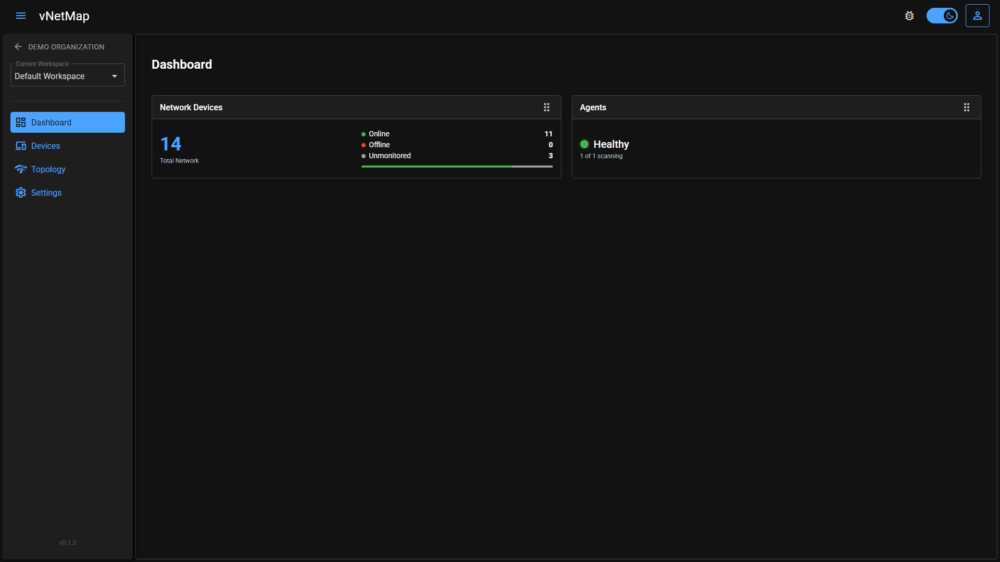
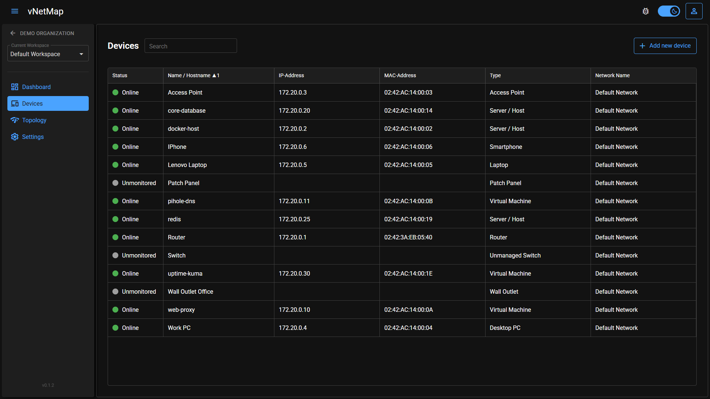
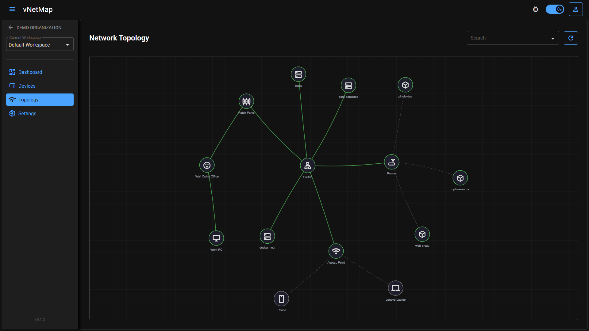
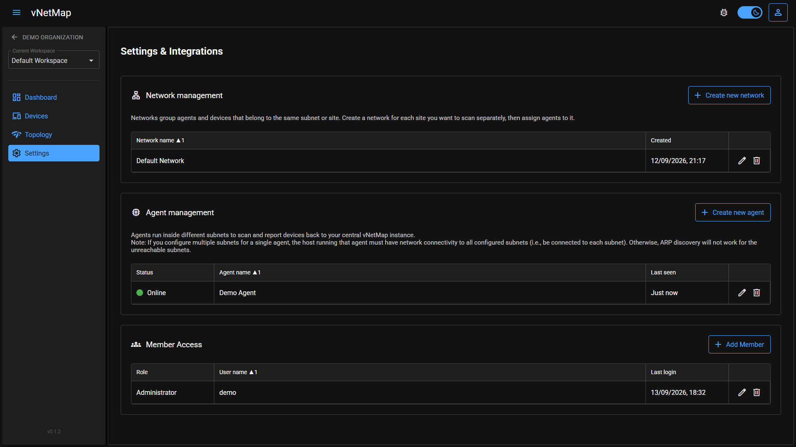

# vNetMap - End-to-End Encrypted Network Documentation & Topology

<table>
  <tr>
    <td style="border: none">
      
    </td>
    <td style="border: none">
      
    </td>
  </tr>
  <tr>
    <td style="border: none">
      
    </td>
    <td style="border: none">
      
    </td>
  </tr>
</table>

Welcome to the vNetMap issue tracker and documentation hub.

vNetMap is a hosted network documentation and topology platform with client-side end-to-end encryption. A lightweight, self-hosted Discovery Agent scans your local network and creates the devices it finds; you document ports, cables and Wi-Fi associations on top of that and view the resulting topology from any browser — no VPN or on-site access required.

> **Status: Beta.** vNetMap is under active development. See [Current Limitations](#-current-limitations) for what it does not do yet.

## ✨ Key Features

- **Interactive Topology Map:** Visualizes switches, routers, access points and endpoints as a graph, including cable links, Wi-Fi associations (client → access point) and parent/child relationships (e.g. virtual machines on a host). Devices are discovered automatically; cable links, Wi-Fi associations and parent/child relationships are currently documented manually.
- **Automated Discovery Agent:** A lightweight Docker container scans your configured subnet with Nmap and probes the ports you choose, on a schedule you control (scan subnet, probe ports, ping interval and discovery interval are configurable per agent in the workspace settings). Devices it finds are created automatically and kept in sync — a name you set manually is never overwritten by a later scan.
- **Detailed Port Management:** Manage switch ports, wall outlets and 1-to-1 patch panel connections (front/rear). Includes bulk generation of ports, visual connection states and custom port names.
- **Device & Agent Status:** Devices and agents are shown as online or offline based on their last check-in from the agent. The UI refreshes periodically. Passive devices (patch panels, wall outlets, unmanaged switches) have no status. There are no alerts or notifications yet.
- **Workspace Dashboard:** An at-a-glance overview of device counts (online / offline / unmonitored) and agent health.
- **Organizations & Workspaces:** Group your infrastructure into organizations and workspaces (e.g. per site, per client, per environment), with role-based access control at both levels (organization: Owner/Admin/Member; workspace: Admin/Viewer).
- **Team Onboarding via Invite Link:** Invite a teammate to an organization with a link instead of an email invite. Each link is single-use and valid for 48 hours. An owner or admin approves the new member, and a workspace admin then grants access to individual workspaces.
- **Recovery Key:** Because your data is encrypted with keys we cannot access, we cannot reset a forgotten password for you. Every account gets a Recovery Key, shown once at signup, that lets you set a new password and regain access to your encrypted data.
- **Client-Side Encryption:** Names, addresses and other descriptive network data are encrypted in your browser (or by the agent) before they are sent to us. See the next section for exactly what is and is not encrypted.

## 🔒 Security & Encryption Model

vNetMap is designed so that the server stores your descriptive network data only as ciphertext and never holds the keys to decrypt it.

- **Client-Side Key Derivation:** Your plaintext password never leaves your browser. Two values are derived from it locally via PBKDF2: a login hash that is sent to the server instead of the password (and hashed again with Argon2 before storage), and a separate key that unlocks your personal private key. That second key is never transmitted.
- **Per-Workspace Encryption Keys:** Each workspace has its own AES-256 key. It is shared with each member individually, wrapped with that member's public key (RSA-OAEP), so the server only ever stores wrapped copies.
- **Field-Level End-to-End Encryption:** The following fields are encrypted with AES-GCM in your browser, or by the Discovery Agent using the same workspace key, before transmission:
  - Devices: name, hostname, manufacturer, model, location, IP address, MAC address, OS name, open ports
  - Ports: name, MAC address
  - Workspace names, network names, agent names, agent scan subnets and probe ports
- **What the server can see:** Not everything is encrypted. The server stores the following in plaintext because it needs it to operate the service: usernames, organization names, device type/category/icon, last-seen timestamps, port numbers and positions, cable type and color, agent intervals and active state, and the relationships between records (which port is linked to which, which device belongs to which network). In other words: the server can see the *shape* of your documentation (e.g. "a 24-port switch is linked to a patch panel"), but not the names, addresses or locations that identify your network.
- **Database breach:** An attacker who obtains the database gets ciphertext for the encrypted fields above plus the plaintext metadata listed above, but no keys to decrypt the former.

**Things you should know:**

- **The agent holds your workspace key.** The generated `docker-compose.yaml` contains `DATA_KEY`, the raw encryption key of that workspace. Treat this file like a password and only deploy the agent on a machine you trust. There is currently no key rotation: deleting an agent does not invalidate a key that has been copied elsewhere.
- **Losing both your password and your Recovery Key means your data is gone.** We cannot recover it for you. Store the Recovery Key somewhere safe (e.g. a password manager).
- **The web app is closed-source.** Until the agent is open-sourced (see below), the claims in this section cannot be independently verified from source code.

## 🚀 How it Works & Quickstart

1. **Create an Account:** Register at [app.vnetmap.com](https://app.vnetmap.com). A first organization, workspace and network are created for you. Save your Recovery Key when it is shown — it is displayed only once and is the only way back into your account if you forget your password.
2. **Configure & Deploy the Agent:** Add a Discovery Agent in your workspace settings and set its scan subnet. Copy the generated `docker-compose.yaml` right away — the agent token is shown only once. The file comes pre-filled with your agent token and workspace key and can run on any machine with visibility into your network. It will look similar to this (always use the generated file; the image tag may differ):
   ```yaml
   # docker-compose.yaml
   services:
     vnetmap-agent:
       image: ghcr.io/vnetmap/vnetmap-agent:0.1.0
       container_name: vnetmap-agent
       environment:
         - AGENT_TOKEN=[generated_agent_token]
         - DATA_KEY=[generated_data_key]
         - BACKEND_URL=https://app.vnetmap.com/api
       cap_add:
         - NET_ADMIN
         - NET_RAW
       volumes:
         - ./data:/app/data
       restart: unless-stopped
       network_mode: "host"
   ```
   `NET_ADMIN`/`NET_RAW` and host networking are required for Nmap-based scanning; run it on any always-on machine (e.g. a Raspberry Pi or small VM) in the network segment you want to scan. Probe ports and scan intervals can be adjusted afterwards by editing the agent.
3. **Document & Visualize:** The agent encrypts its scan results and sends them to your workspace, where they are decrypted in your browser with your locally held key. Add ports, cable links and Wi-Fi associations to complete the topology.

## 🚧 Current Limitations

- **No automatic cable or link detection.** Nmap cannot see which device is plugged into which switch port. Links are entered manually. Automatic detection via SNMP/LLDP is planned.
- **Discovery uses Nmap only.** SNMP is not supported yet.
- **Hostname detection is inconsistent.** Depending on your network (mDNS, NetBIOS, DNS), some devices are discovered by IP address only and need to be named manually.
- **No alerting.** Online/offline status is visible in the UI only.
- **No key rotation** for workspace keys or agent tokens.
- **Up to 2,000 devices per workspace.**

## ⚠️ Open Source Status

The vNetMap backend and frontend are closed-source. We plan to open-source the Discovery Agent so you can verify what data it gathers and how it encrypts that data before anything leaves your network. No date is set yet.

## 🐛 How to report a bug or request a feature

Use this repository to track bugs, report issues, and request features for the vNetMap ecosystem.

Please use the available Issue Templates: select "New Issue" and choose either a bug report or a feature request, then follow the instructions in the form. Check for existing issues before creating a new one to prevent duplicates.

## 🛡️ Security Vulnerabilities

If you find a security flaw, do not post it publicly. Please email [support@vnetmap.com](mailto:support@vnetmap.com?subject=Report%20Security%20Vulnerabilities) directly.
